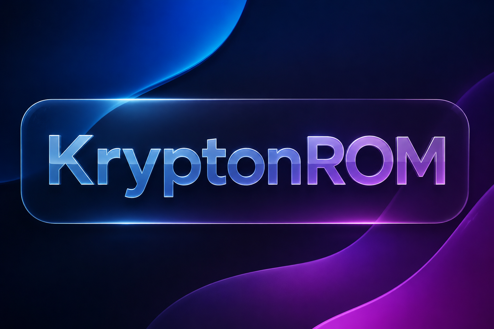

# ⚡ KryptonROM Engine 

> « A flexible Samsung One UI ROM Engine focused on custom bases, system modifications, performance, and experimentation. »

---

## 📱 One UI Support

Supported One UI Versions:
* **One UI 4**
* **One UI 5**
* **One UI 6**
* **One UI 7**
* **One UI 8**
* **One UI 8.5**

> 💡 **Note:** **KryptonROM** is *not* locked to one specific base per One UI version. We work with different Samsung bases depending on the device target and the goal of each build.

---

## 🧩 Example Bases

We utilize and port multiple compatible Samsung device bases, including:

* **Galaxy S21 FE**
* **Galaxy S23 FE**
* **Galaxy A73**
* **Galaxy S26 FE**
* **Stock Samsung Base Firmware**
* *And other cross-compatible bases...*

---

## 🛠️ What We Do

- 🔄 **Adapt** different One UI generations seamlessly across devices.
- 🧩 **Combine & Modify** system structures from different device bases.
- ⚙️ **Build & Patch** custom system binaries and framework libraries (`services.jar`, `ssrm.jar`, etc.).
- 🚀 **Boost Performance** and maximize overall system responsiveness.
- 🔋 **Optimize Power** consumption and refine battery profiles.
- 🔬 **Experiment** with cross-generation system components and features.
- 🧪 **Test** various framework and base image combinations for peak stability.

---

## 💡 Experimental Concepts

**KryptonROM** continuously tests and implements concepts such as:

```text
• One UI 5 System  ➔  Newer Firmware Binary Integration
• S21 FE Base       ➔  Ported & Adapted to Target Devices
• A73 Base          ➔  Custom Optimized One UI Build
• Custom Libraries  ➔  Enhanced System Performance & Stability
